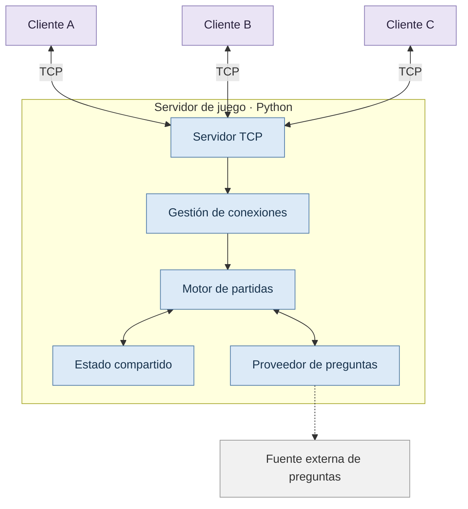

 

# TRIVIA
### Multiplayer Quiz System

**Un juego de preguntas multijugador construido para explorar la concurrencia, la comunicación en red y la sincronización de procesos.**

 

 

[Descripción](#descripción) · [Funcionamiento](#funcionamiento) · [Arquitectura](#arquitectura) · [Tecnologías](#tecnologías) · [Desarrollo](#plan-de-desarrollo)

---

## Descripción

**TRIVIA** es un proyecto académico de Computación que propone desarrollar un juego de preguntas y respuestas en el que múltiples jugadores participan simultáneamente a través de una arquitectura cliente-servidor.

El servidor coordina las partidas, distribuye las preguntas, recibe las respuestas y administra los puntajes. Los jugadores interactúan con el sistema mediante conexiones de red, mientras el servidor gestiona las solicitudes concurrentes y mantiene consistente el estado de cada partida.

El objetivo principal es aplicar conceptos fundamentales de sistemas concurrentes y comunicación en red en una aplicación práctica, comprobable y extensible.

## Objetivos del proyecto

<table>
<tr>
<td width="50%" valign="top">

### Comunicación en red

Implementar conexiones cliente-servidor mediante sockets TCP y definir un protocolo de mensajes.

</td>
<td width="50%" valign="top">

### Concurrencia

Atender múltiples jugadores simultáneamente mediante hilos de ejecución.

</td>
</tr>
<tr>
<td width="50%" valign="top">

### Sincronización

Coordinar el acceso al estado compartido y prevenir condiciones de carrera.

</td>
<td width="50%" valign="top">

### Procesamiento asíncrono

Gestionar eventos temporales y operaciones que pueden completarse en distintos momentos.

</td>
</tr>
<tr>
<td width="50%" valign="top">

### Integración externa

Investigar la obtención de preguntas desde servicios externos y gestionar sus posibles fallos.

</td>
<td width="50%" valign="top">

### Despliegue reproducible

Preparar la ejecución del sistema mediante Docker Compose, según los requisitos finales.

</td>
</tr>
</table>

## Funcionamiento

El flujo previsto de una partida es el siguiente:

1. **Crear una sala.** Un anfitrión inicia una partida y obtiene un código de acceso.
2. **Conectar jugadores.** Los participantes se conectan al servidor e ingresan a la sala.
3. **Iniciar la partida.** El servidor envía una pregunta y establece el límite de tiempo.
4. **Recibir respuestas.** Los jugadores responden de manera independiente mientras el servidor continúa atendiendo conexiones.
5. **Procesar la ronda.** El servidor valida las respuestas, calcula los puntajes y determina el cierre de la ronda.
6. **Publicar resultados.** Todos los participantes reciben los resultados y la clasificación actualizada.
7. **Finalizar la partida.** El sistema muestra la clasificación definitiva.

## Arquitectura

La arquitectura inicial contempla un servidor central y múltiples clientes conectados por TCP.

### Componentes principales

| Componente | Responsabilidad |
|---|---|
| Servidor TCP | Aceptar conexiones y gestionar la comunicación con los clientes. |
| Gestión de conexiones | Atender las operaciones de red de cada participante. |
| Motor de partidas | Controlar salas, rondas, temporizadores y reglas del juego. |
| Estado compartido | Mantener participantes, respuestas y puntajes de manera consistente. |
| Proveedor de preguntas | Obtener y validar preguntas locales o provenientes de fuentes externas. |

El diagrama representa la arquitectura prevista, no una implementación terminada. Los límites entre componentes y los mecanismos de comunicación se definirán durante la etapa de diseño.

## Conceptos de Computación

El proyecto se utilizará para estudiar y demostrar los siguientes conceptos:

| Concepto | Aplicación en el sistema |
|---|---|
| Sockets TCP | Comunicación entre clientes y servidor. |
| Hilos (`threading`) | Atención concurrente de múltiples conexiones. |
| Condiciones de carrera | Conflictos potenciales al registrar respuestas o actualizar puntajes. |
| Exclusión mutua (`Lock`) | Protección de las secciones críticas del estado compartido. |
| Asincronismo | Coordinación de respuestas, temporizadores y operaciones remotas. |
| Procesamiento paralelo | Evaluación e implementación de procesos adicionales si lo exige la consigna. |
| Tolerancia a fallos | Gestión de desconexiones, mensajes inválidos y errores de fuentes externas. |

La implementación deberá distinguir entre concurrencia y paralelismo, y justificar los mecanismos elegidos en función de los requisitos de la materia.

## Tecnologías

<table>
<thead>
<tr>
<th>Tecnología</th>
<th>Uso previsto</th>
<th>Estado</th>
</tr>
</thead>
<tbody>
<tr>
<td>Python</td>
<td>Lenguaje principal</td>
<td>Definido</td>
</tr>
<tr>
<td><code>socket</code></td>
<td>Comunicación TCP</td>
<td>Planificado</td>
</tr>
<tr>
<td><code>threading</code></td>
<td>Concurrencia</td>
<td>Planificado</td>
</tr>
<tr>
<td>JSON</td>
<td>Formato de mensajes</td>
<td>Propuesto</td>
</tr>
<tr>
<td>Git y GitHub</td>
<td>Control de versiones y organización</td>
<td>Previsto</td>
</tr>
<tr>
<td>Docker Compose</td>
<td>Despliegue reproducible</td>
<td>Pendiente de implementación</td>
</tr>
<tr>
<td>Redis y Celery</td>
<td>Posible gestión de tareas en segundo plano</td>
<td>En evaluación</td>
</tr>
</tbody>
</table>

Las tecnologías adicionales se incorporarán únicamente cuando exista una necesidad técnica o un requisito académico que las justifique.

## Plan de desarrollo

<table>
<thead>
<tr>
<th>Etapa</th>
<th>Objetivo</th>
<th>Estado</th>
</tr>
</thead>
<tbody>
<tr>
<td>00</td>
<td>Diseño, arquitectura y organización</td>
<td>En planificación</td>
</tr>
<tr>
<td>01</td>
<td>Servidor TCP y clientes de consola</td>
<td>Pendiente</td>
</tr>
<tr>
<td>02</td>
<td>Salas y gestión de participantes</td>
<td>Pendiente</td>
</tr>
<tr>
<td>03</td>
<td>Motor de preguntas y puntuación</td>
<td>Pendiente</td>
</tr>
<tr>
<td>04</td>
<td>Sincronización y pruebas de concurrencia</td>
<td>Pendiente</td>
</tr>
<tr>
<td>05</td>
<td>Integración de preguntas externas</td>
<td>Pendiente</td>
</tr>
<tr>
<td>06</td>
<td>Contenerización, documentación y entrega</td>
<td>Pendiente</td>
</tr>
</tbody>
</table>

## Organización del equipo

Proyecto desarrollado por:

- **Constanza Arancibia**
- **Mia Manchaca**
- **Agustina Chamorro**

El trabajo se organizará mediante GitHub Issues, con tareas delimitadas, responsables y criterios de aceptación. La integración se realizará progresivamente, priorizando las pruebas de comunicación y concurrencia antes de incorporar funcionalidades visuales.

## Alcance inicial

La primera versión priorizará el funcionamiento correcto de las conexiones, las partidas y la sincronización del estado compartido.

Las interfaces gráficas, las animaciones, las estadísticas históricas y las funcionalidades complementarias se considerarán mejoras posteriores.

## Estado del proyecto

El proyecto se encuentra en la etapa de planificación y definición de la arquitectura. Los requisitos técnicos definitivos y las tecnologías complementarias se ajustarán según las indicaciones del docente.

---

**TRIVIA · Computación**

*Aprender sistemas concurrentes construyendo un sistema concurrente.*

