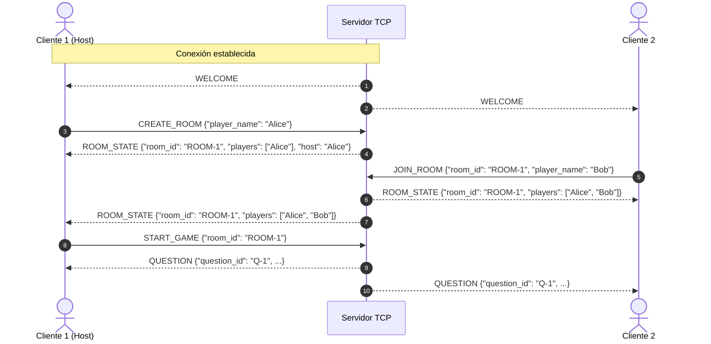
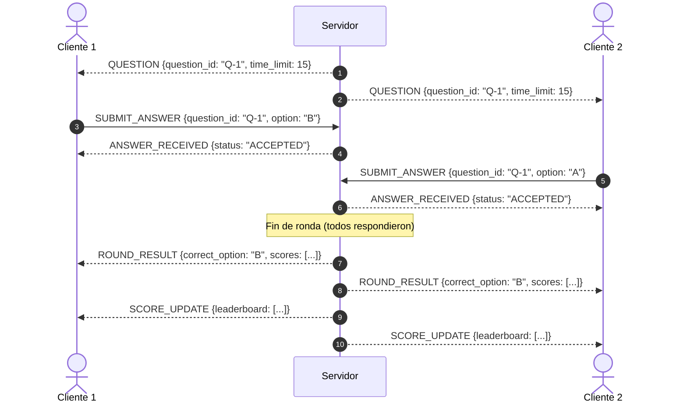

# Especificación Formal del Protocolo de Comunicación - TRIVIA

Este documento define la especificación técnica del protocolo de capa de aplicación utilizado para la comunicación entre los clientes y el servidor central de **TRIVIA** sobre una conexión de flujo TCP continuo.

---

## 1. Fundamentos de Red y Enmarcado (Message Framing)

### 1.1 Naturaleza del Stream TCP
TCP es un protocolo orientado a flujo de bytes (*stream-oriented*). No preserva los límites de los mensajes a nivel de aplicación (*message boundaries*):
- **Concatenación de paquetes (*sticky packets*):** Múltiples escrituras pequeñas pueden consolidarse y ser entregadas juntas en un único `recv()` (por ejemplo, `msg1\nmsg2\n`).
- **Fragmentación de paquetes (*packet fragmentation*):** Un único mensaje grande o una lectura parcial de la red puede recibirse cortada en fragmentos sucesivos (por ejemplo, `{"ty` en un `recv()`, y `pe": "PING"}\n` en el siguiente).

### 1.2 Delimitador de Mensajes
Para resolver la fragmentación y concatenación sin requerir cabeceras binarias complejas, el protocolo utiliza **JSON delimitado por salto de línea (`\n`)** (*Line-Delimited JSON / NDJSON*):
- Todo mensaje debe codificarse en **UTF-8**.
- Cada mensaje termina estrictamente con el carácter ASCII `\n` (`0x0A`).
- Ningún mensaje puede contener caracteres de salto de línea no escapados dentro de sus valores de texto (la serialización estándar de JSON escapa saltos de línea como `\n`).
- El receptor acumula bytes en un búfer local, extrae mensajes completos al encontrar `\n`, y preserva los remanentes incompletos para los siguientes ciclos de lectura.

```
+-------------------------------------------------------------------+
|  {"type": "PING", "request_id": "req-1", "payload": {}} \n        |  <- Mensaje 1
+-------------------------------------------------------------------+
|  {"type": "CREATE_ROOM", "request_id": "req-2", "payload": ...} \n |  <- Mensaje 2
+-------------------------------------------------------------------+
```

---

## 2. Envoltorio Estándar de Mensaje (Envelope)

Todos los mensajes intercambiados (tanto de cliente a servidor como de servidor a cliente) deben respetar la siguiente estructura JSON en su raíz:

```json
{
  "type": "STRING",
  "request_id": "STRING",
  "payload": {}
}
```

### Campos del Envoltorio:
| Campo | Tipo | Requerido | Descripción |
|---|---|---|---|
| `type` | `string` | Sí | Identificador en mayúsculas del tipo de mensaje / evento. |
| `request_id` | `string` | Sí | Identificador único de solicitud (UUID o correlador). Permite emparejar peticiones con sus respuestas o trazar auditoría. Si un evento es iniciado asíncronamente por el servidor (broadcast), se puede utilizar un ID con prefijo `srv-` o UUID. |
| `payload` | `object` | Sí | Objeto JSON (diccionario) con los datos específicos de la acción o evento. No puede ser `null`, array o tipo primitivo. |

---

## 3. Catálogo Formal de Mensajes

El protocolo divide los mensajes en cinco categorías operativas:
1. **Conexión y Diagnóstico**
2. **Salas (Lobby)**
3. **Partida y Preguntas**
4. **Resultados y Puntuación**
5. **Desconexión y Salida**

---

### 3.1 Conexión y Diagnóstico

#### `WELCOME` (Servidor -> Cliente)
Enviado por el servidor inmediatamente tras aceptar la conexión TCP. Informa al cliente que la sesión está establecida.
- **Payload:**
  ```json
  {
    "client_id": "str (UUID asignado al socket)",
    "server_version": "str",
    "server_time": "str (ISO 8601 UTC)"
  }
  ```

#### `PING` (Bidireccional: Cliente <-> Servidor)
Utilizado para verificar la disponibilidad de la conexión (*heartbeat*) o calcular la latencia de ida y vuelta.
- **Payload:**
  ```json
  {
    "timestamp": "float / int (timestamp Unix en segundos o milisegundos)"
  }
  ```

#### `PONG` (Bidireccional: Respuesta a PING)
Respuesta inmediata a un `PING`. Debe conservar el mismo `request_id` del `PING` original.
- **Payload:**
  ```json
  {
    "original_timestamp": "float / int"
  }
  ```

#### `ERROR` (Servidor -> Cliente / Bidireccional)
Notificación estructurada de que una operación ha fallado o la petición fue inválida.
- **Payload:**
  ```json
  {
    "code": "str (código de error en mayúsculas)",
    "message": "str (descripción legible para humanos)",
    "details": "object (opcional, metadatos o contexto adicional)"
  }
  ```

---

### 3.2 Gestión de Salas (Lobby)

#### `CREATE_ROOM` (Cliente -> Servidor)
Solicita la creación de una nueva sala de juego. El emisor se convierte en el anfitrión (*host*).
- **Payload:**
  ```json
  {
    "player_name": "str (nombre del jugador)",
    "room_name": "str (opcional, nombre descriptivo de la sala)",
    "max_players": "int (opcional, por defecto 4)",
    "rounds_count": "int (opcional, por defecto 5)"
  }
  ```

#### `JOIN_ROOM` (Cliente -> Servidor)
Solicita unirse a una sala existente mediante su identificador o código de acceso.
- **Payload:**
  ```json
  {
    "room_id": "str (código de la sala, ej: ROOM-1234)",
    "player_name": "str (nombre del jugador)"
  }
  ```

#### `ROOM_STATE` (Servidor -> Cliente / Broadcast)
Informa el estado actualizado de la sala a todos los miembros (cuando entra/sale alguien o cambia la configuración).
- **Payload:**
  ```json
  {
    "room_id": "str",
    "room_name": "str",
    "host_id": "str",
    "status": "str (WAITING | IN_GAME | FINISHED)",
    "players": [
      {
        "player_id": "str",
        "name": "str",
        "is_host": "bool",
        "is_ready": "bool"
      }
    ],
    "max_players": "int"
  }
  ```

#### `START_GAME` (Cliente -> Servidor)
Enviado por el anfitrión para indicar que la partida debe comenzar.
- **Payload:**
  ```json
  {
    "room_id": "str"
  }
  ```

---

### 3.3 Partida y Dinámica de Preguntas

#### `QUESTION` (Servidor -> Cliente / Broadcast)
Difunde la pregunta actual a todos los jugadores de la sala al iniciar una ronda.
- **Payload:**
  ```json
  {
    "room_id": "str",
    "round_number": "int",
    "total_rounds": "int",
    "question_id": "str",
    "category": "str",
    "difficulty": "str (easy | medium | hard)",
    "prompt": "str (enunciado de la pregunta)",
    "options": [
      {"id": "A", "text": "Opción 1"},
      {"id": "B", "text": "Opción 2"},
      {"id": "C", "text": "Opción 3"},
      {"id": "D", "text": "Opción 4"}
    ],
    "time_limit_seconds": "int"
  }
  ```

#### `SUBMIT_ANSWER` (Cliente -> Servidor)
Envía la respuesta seleccionada por un jugador para la ronda en curso.
- **Payload:**
  ```json
  {
    "room_id": "str",
    "question_id": "str",
    "selected_option_id": "str (ej: 'A', 'B', 'C', 'D')",
    "elapsed_seconds": "float"
  }
  ```

#### `ANSWER_RECEIVED` (Servidor -> Cliente)
Confirmación inmediata enviada exclusivamente al jugador que envió `SUBMIT_ANSWER`.
- **Payload:**
  ```json
  {
    "room_id": "str",
    "question_id": "str",
    "status": "ACCEPTED",
    "timestamp": "float"
  }
  ```

#### `ROUND_RESULT` (Servidor -> Cliente / Broadcast)
Difunde el cierre de la ronda tras agotarse el tiempo o tras haber respondido todos los participantes.
- **Payload:**
  ```json
  {
    "room_id": "str",
    "round_number": "int",
    "correct_option_id": "str",
    "explanation": "str (opcional)",
    "round_scores": [
      {
        "player_id": "str",
        "player_name": "str",
        "points_earned": "int",
        "answered": "bool",
        "correct": "bool",
        "response_time": "float"
      }
    ]
  }
  ```

---

### 3.4 Resultados y Puntuación

#### `SCORE_UPDATE` (Servidor -> Cliente / Broadcast)
Difunde la tabla de posiciones acumulada después de procesar una ronda.
- **Payload:**
  ```json
  {
    "room_id": "str",
    "leaderboard": [
      {
        "rank": "int",
        "player_id": "str",
        "player_name": "str",
        "total_score": "int",
        "correct_answers": "int"
      }
    ]
  }
  ```

#### `GAME_OVER` (Servidor -> Cliente / Broadcast)
Señaliza la finalización completa de la partida y anuncia al ganador o podio definitivo.
- **Payload:**
  ```json
  {
    "room_id": "str",
    "winner_id": "str",
    "winner_name": "str",
    "final_standings": [
      {
        "rank": "int",
        "player_id": "str",
        "player_name": "str",
        "total_score": "int"
      }
    ]
  }
  ```

---

### 3.5 Desconexión y Salida

#### `PLAYER_LEFT` (Servidor -> Cliente / Broadcast / Cliente -> Servidor)
Notifica que un jugador se retiró voluntariamente o perdió la conexión.
- **Payload:**
  ```json
  {
    "room_id": "str",
    "player_id": "str",
    "player_name": "str",
    "reason": "str (VOLUNTARY | TIMEOUT | CONNECTION_LOST | KICKED)",
    "new_host_id": "str (opcional, si el que salió era el host)"
  }
  ```

---

## 4. Contrato Estructurado de Errores

Cuando una solicitud no puede ser atendida o viola las reglas del negocio, el servidor responde con un mensaje `ERROR` que mantiene el `request_id` de la petición causante.

### Formato:
```json
{
  "type": "ERROR",
  "request_id": "req-99",
  "payload": {
    "code": "ROOM_NOT_FOUND",
    "message": "La sala solicitada no existe o ya ha sido cerrada.",
    "details": {
      "room_id": "ROOM-XYZ"
    }
  }
}
```

### Catálogo de Códigos de Error:

| Código | Significado | Causa típica |
|---|---|---|
| `MALFORMED_JSON` | El mensaje no es un JSON sintácticamente válido. | Fragmentación no controlada o payload corrupto. |
| `INVALID_ENVELOPE` | Falta `type`, `request_id` o `payload` no es diccionario. | El cliente no respeta el esquema base. |
| `UNKNOWN_MESSAGE_TYPE` | El valor de `type` no existe en el catálogo formal. | Versiones incompatibles o comando inexistente. |
| `INVALID_PAYLOAD` | Los campos dentro de `payload` no cumplen los tipos esperados. | Falta un parámetro obligatorio o tipo incorrecto. |
| `ROOM_NOT_FOUND` | La sala indicada por `room_id` no existe. | Código de sala erróneo o sala cerrada. |
| `ROOM_FULL` | La sala ya alcanzó el cupo máximo de jugadores. | Intento de `JOIN_ROOM` en sala colmada. |
| `GAME_ALREADY_STARTED` | La partida ya comenzó y no admite nuevos miembros. | Intento de `JOIN_ROOM` tardío. |
| `NOT_HOST` | Solo el anfitrión de la sala puede iniciar la partida. | Jugador no host emite `START_GAME`. |
| `ALREADY_ANSWERED` | El jugador ya envió respuesta para la ronda activa. | Envío duplicado de `SUBMIT_ANSWER`. |
| `TIME_EXPIRED` | El tiempo para responder la ronda actual ya venció. | Envío tardío de `SUBMIT_ANSWER`. |
| `INVALID_ROUND_STATE` | No hay ninguna ronda en juego en este momento. | Envío de respuestas fuera de tiempo de juego. |
| `PLAYER_NOT_IN_ROOM` | El jugador no pertenece a la sala indicada. | Solicitud dirigida a sala ajena. |
| `INTERNAL_SERVER_ERROR` | Error imprevisto en la ejecución del servidor. | Excepción no capturada en el servidor. |

---

## 5. Diagramas de Secuencia

### 5.1 Flujo de Creación, Unión y Comienzo de Sala



### 5.2 Flujo de Ronda y Respuestas


